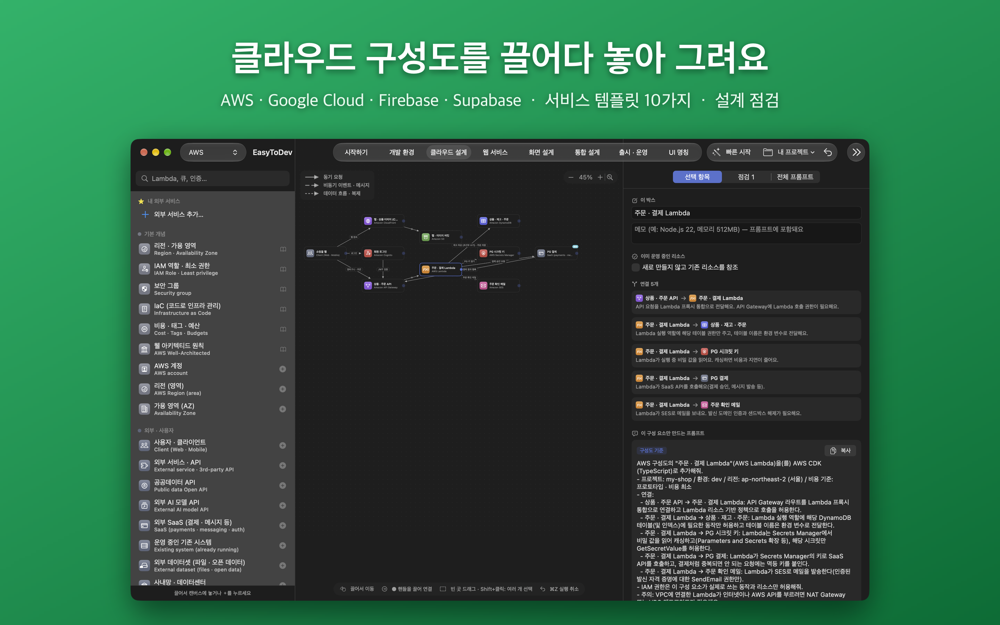
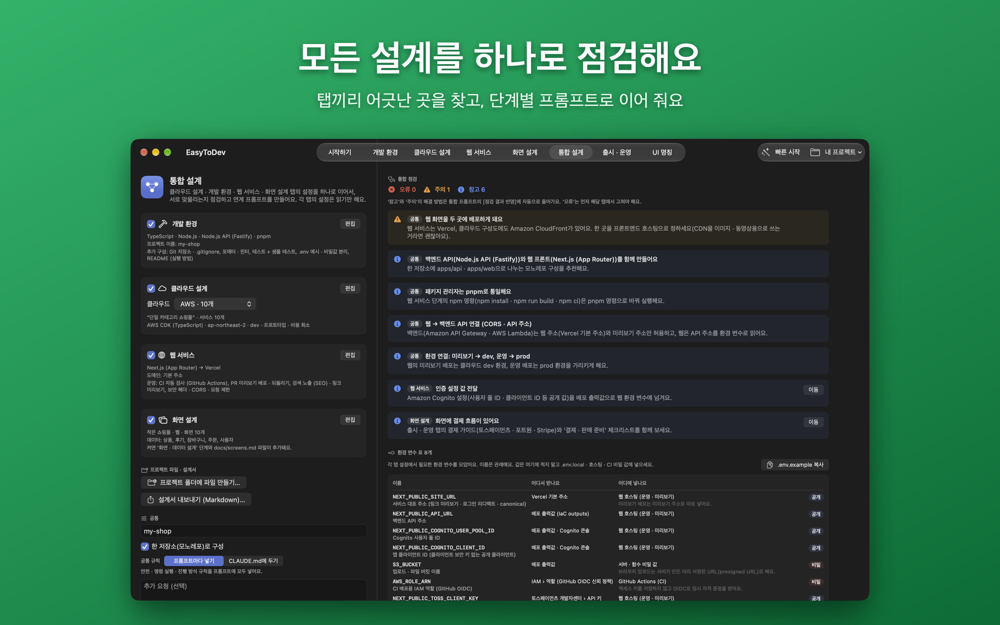
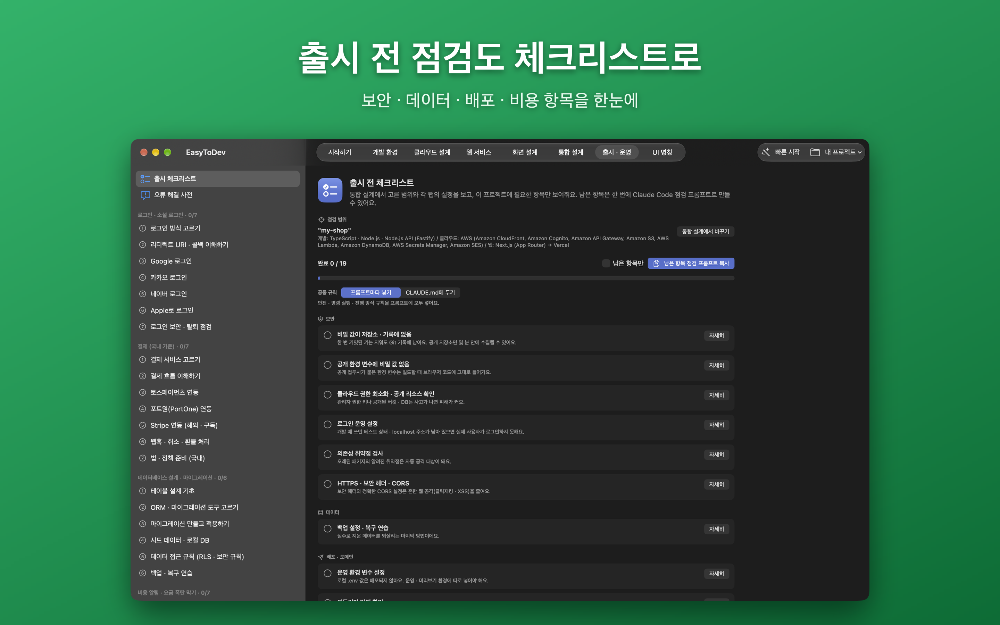

# EasyToDev 지원

EasyToDev는 서비스를 만들기 전에 **화면 · 데이터 · 클라우드 · 배포를 한곳에서 설계**하고, Claude Code 같은 AI 코딩 도구에 그대로 붙여 넣을 수 있는 **단계별 프롬프트**를 만들어 주는 macOS 앱이에요.
계정이나 로그인이 필요 없고, 모든 설계는 내 Mac에만 저장돼요.

- [화면 미리보기](#화면-미리보기)
- [주요 기능](#주요-기능)
- [시작하기](#시작하기)
- [자주 묻는 질문](#자주-묻는-질문)
- [문제 해결](#문제-해결)
- [개인정보 처리방침](#개인정보-처리방침)
- [문의하기](#문의하기)

---

## 화면 미리보기

## 주요 기능

| 탭 | 하는 일 |
|---|---|
| **시작하기** | Mac에 개발 도구(Homebrew · Git · VS Code · Node.js · Python 등)를 처음 설치하는 순서를 안내하고, 설치된 도구를 점검해요. |
| **개발 환경** | 언어 · 도구를 고르면 환경 설정 프롬프트와 CLAUDE.md · 권한 · 훅 · 스킬 · CI 파일 초안을 만들고, 고른 프로젝트 폴더에 바로 써요. |
| **클라우드 설계** | AWS · Google Cloud · Firebase · Supabase 서비스를 끌어다 놓아 구성도를 그리고, 설계 점검과 비용 기준에 맞춘 구축 프롬프트를 만들어요. 서비스 템플릿 10가지. |
| **웹 서비스** | 호스팅 · 도메인 · 운영 기능을 골라 배포까지 이어지는 프롬프트를 만들어요. |
| **화면 설계** | 화면을 깊이대로 나누고 부품을 배치해 흐름도와 DB 설계 프롬프트를 만들어요. 예시 14가지. 클라우드 구성도와 연동할 수 있어요. |
| **통합 설계** | 모든 탭을 합쳐 점검하고, 계획부터 연결 확인까지 단계별 프롬프트와 설계서를 만들어요. 프로젝트 폴더를 읽어 진행 상황도 알려줘요. |
| **출시 · 운영** | 출시 전에 확인할 보안 · 데이터 · 배포 · 비용 항목을 체크리스트로 정리해요. |
| **UI 명칭** | 웹 · 모바일 화면 요소의 정확한 이름을 그림과 함께 찾아봐요. |

## 시작하기

1. 앱을 열고 툴바의 **빠른 시작**을 누르세요. 몇 가지 질문에 답하면 모든 탭이 견본 프로젝트로 채워져요.
2. 각 탭에서 내 서비스에 맞게 고쳐요.
3. **통합 설계** 탭에서 단계별 프롬프트를 하나씩 복사해, 프로젝트 폴더에서 실행한 AI 코딩 도구(예: Claude Code)에 붙여 넣으세요.

요구 사항: macOS 14 Sonoma 이상

## 자주 묻는 질문

**Q. AI를 쓰려면 요금이나 계정이 필요한가요?**
EasyToDev 자체는 AI를 실행하지 않아서 앱 안에서 요금이 나가지 않아요. 만든 프롬프트를 붙여 넣는 AI 코딩 도구(Claude Code 등)는 각 서비스의 계정과 요금제가 필요해요.

**Q. 프롬프트에 API 키나 비밀번호를 넣어야 하나요?**
아니요. EasyToDev가 만드는 프롬프트는 키 · 토큰 값을 쓰지 않고 환경 변수 이름만 쓰도록 안내해요. 실제 값은 `.env.local`이나 호스팅 · 클라우드의 비밀 값 설정에 직접 넣으세요.

**Q. '내 Mac 환경 자동 점검'에서 설치한 도구가 '찾지 못했어요'로 나와요.**
App Store 버전은 보안 정책(App Sandbox) 때문에 터미널 명령을 실행할 수 없어요. 그래서 도구가 보통 설치되는 위치(Homebrew · `~/.local/bin` · 응용 프로그램 폴더 등)에 파일이 있는지만 확인해요. 다른 위치에 설치했다면 항목을 눌러 나오는 '확인' 명령을 터미널에서 실행해 보세요. 찾지 못했다고 설치가 안 된 것은 아니에요.

**Q. 진행 상황에 '커밋하지 않은 변경' 수가 나오지 않아요.**
같은 이유로 App Store 버전은 git 명령을 실행할 수 없어서, `.git` 폴더에서 브랜치와 마지막 커밋만 읽어요. 대신 다음 단계 프롬프트가 `git status`로 먼저 확인하게 해요.

**Q. 프로젝트 폴더에 파일을 쓰면 기존 파일이 지워지나요?**
아니요. 쓰기 전에 기존 파일과 같은지 · 다른지 보여주고, 파일마다 건너뛰기 · 끝에 덧붙이기 · 덮어쓰기를 고를 수 있어요. 덮어쓸 때는 기존 파일을 `파일이름.bak-날짜시간`으로 보관해요. 사용자가 고른 폴더 밖의 파일은 건드리지 않아요.

**Q. 여러 프로젝트를 따로 관리할 수 있나요?**
툴바의 프로젝트 메뉴(새 프로젝트 · 관리…)에서 프로젝트를 만들고 전환할 수 있어요. 프로젝트를 파일(.json)로 내보내고 다른 Mac에서 가져올 수도 있어요.

**Q. 화면 설계와 클라우드 설계를 연동하면 무엇이 바뀌나요?**
한쪽에서 템플릿을 고르면 다른 쪽도 짝이 되는 템플릿으로 바뀌고, 화면에 로그인 · 데이터 · 파일 · 결제가 생기면 구성도에 필요한 서비스를 더해요. 자동으로는 더하기만 하고 지우지 않으며, ⌘Z로 되돌릴 수 있어요. '별도로 진행'을 고르면 서로 건드리지 않아요.

## 문제 해결

| 증상 | 해결 방법 |
|---|---|
| 프로젝트 폴더에 파일을 쓸 수 없어요 | '폴더 고르기'로 폴더를 다시 골라 주세요. 폴더를 옮기거나 이름을 바꾸면 접근 권한을 다시 받아야 해요. |
| 예전에 만든 설계가 보이지 않아요 | App Store 버전은 앱 전용 저장 공간을 써요. 다른 빌드에서 쓰던 설계는 그 앱에서 프로젝트 메뉴 › 내보내기 후, 새 앱에서 가져오기 하세요. |
| 생성된 프롬프트가 예상과 달라요 | 각 탭의 '점검' 항목을 먼저 확인하세요. 점검 결과의 보완 지시가 프롬프트에 들어가요. 그래도 이상하면 아래로 알려 주세요. |
| 구성도가 화면에서 보이지 않아요 | 캔버스 오른쪽 위 확대 · 축소 버튼 옆의 돋보기(화면에 맞추기) 버튼을 누르세요. |

## 개인정보 처리방침

EasyToDev는 **개인정보를 수집하지 않아요.**

- 계정 · 로그인 · 분석 도구 · 광고 · 추적 기능이 없어요.
- 설계 · 설정은 이 Mac의 앱 저장 공간에만 저장되고, 개발자를 포함한 누구에게도 전송되지 않아요.
- 사용자가 고른 폴더의 파일은 진행 상황을 보여주거나 사용자가 요청한 파일을 쓸 때만 이 Mac 안에서 읽고 써요.
- 네트워크는 앱 안의 문서 화면과 공식 문서 링크를 열 때만 써요.
- 프롬프트는 사용자가 직접 복사해 다른 도구에 붙여 넣을 때만 앱 밖으로 나가요. 그 도구의 개인정보 처리는 해당 서비스의 정책을 따라요.

## 문의하기

버그 제보 · 기능 제안 · 사용 문의는 [GitHub Issues](https://github.com/Gugoon/easyToDevReadme/issues)에 남겨 주세요.
문의할 때 macOS 버전, 앱 버전(EasyToDev › EasyToDev에 관하여), 어떤 탭에서 무엇을 했는지 알려 주시면 빨리 확인할 수 있어요.
프롬프트나 설계 파일을 첨부할 때는 키 · 토큰 같은 비밀 값이 없는지 확인해 주세요.

---

## English summary

**EasyToDev** is a macOS app that helps you design a software project in one place — screens, data, cloud architecture (AWS · Google Cloud · Firebase · Supabase), web hosting, and a launch checklist — and turns the design into step-by-step prompts you can paste into an AI coding tool such as Claude Code. No account is required, and the app itself does not run AI models.

- **Requirements:** macOS 14 Sonoma or later
- **Privacy:** EasyToDev does not collect any personal data. Designs and settings stay on your Mac; there is no analytics, tracking, or ads.
- **Sandbox note:** The App Store version cannot run Terminal commands, so the environment check only looks for tools at common install locations, and the progress reader reads branch and last commit from the `.git` folder.
- **Support:** Please open an issue at [GitHub Issues](https://github.com/Gugoon/easyToDevReadme/issues).
