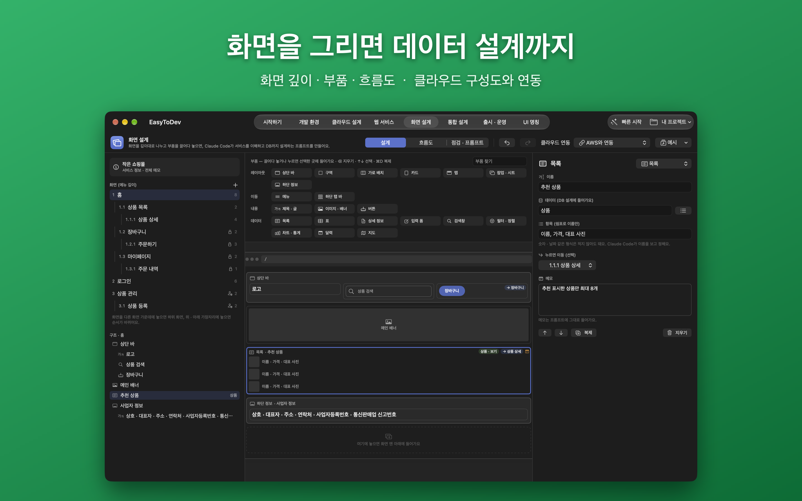
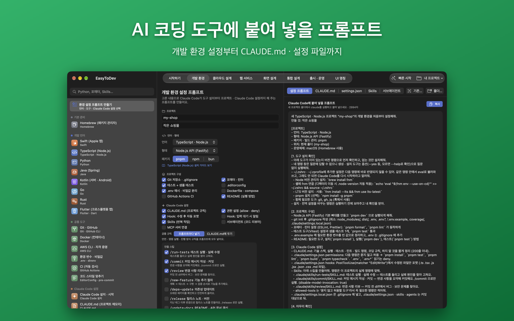
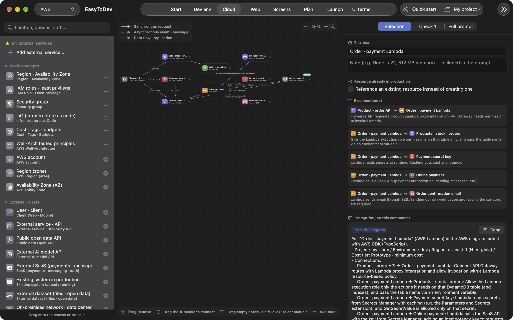
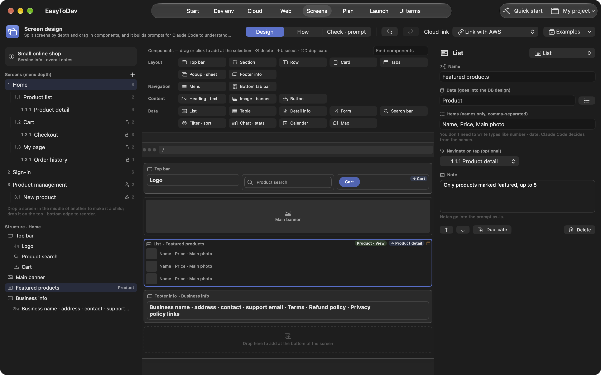
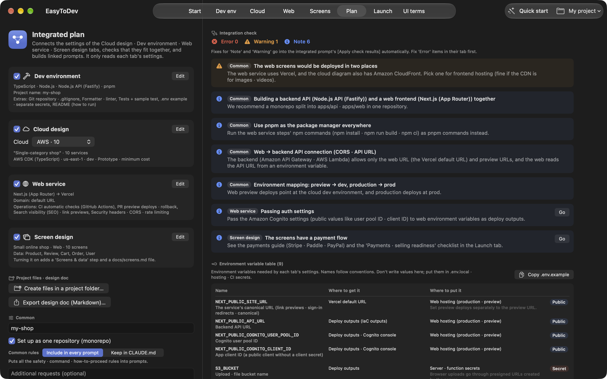
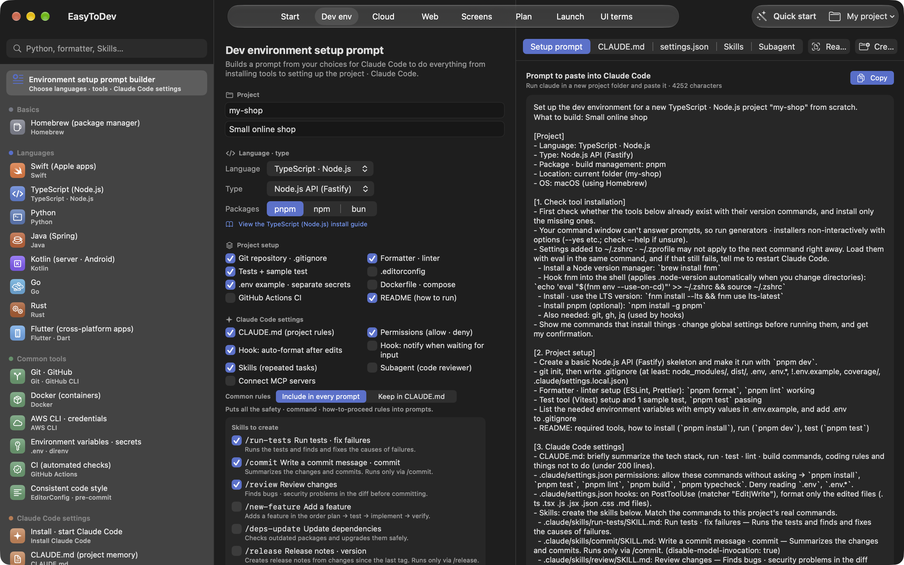
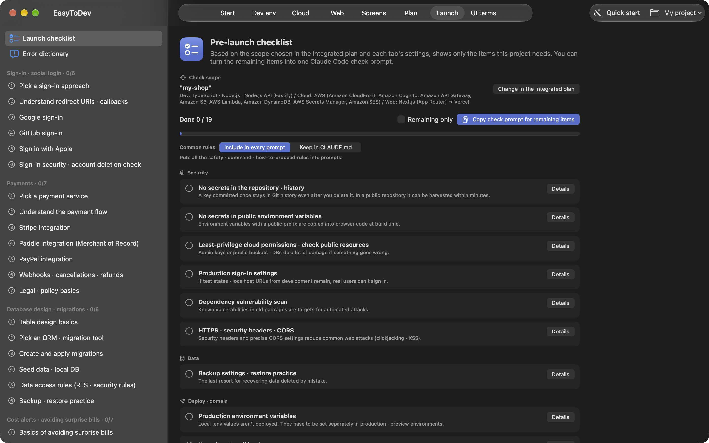

# EasyToDev

**한국어** · [English](#english)

서비스 설계를 정리하고 AI 코딩 도구용 단계별 프롬프트를 만들어 주는 macOS 앱이에요.

- 요구 사항: macOS 14 이상

## 화면

## 지원

문의 · 버그 제보 · 의견은 [GitHub Issues](https://github.com/Gugoon/easyToDevReadme/issues)에 남겨 주세요.

## 개인정보 처리방침

EasyToDev는 개인정보를 수집 · 저장 · 공유하지 않아요.

- 계정 · 로그인 · 분석 · 광고 · 추적 기능이 없어요.
- 모든 설계와 설정은 사용자의 Mac에만 저장되고, 개발자나 서버로 전송되지 않아요.
- 사용자가 고른 폴더의 파일은 사용자가 요청할 때만 Mac 안에서 읽고 써요.

---

## English

EasyToDev is a macOS app that helps you plan a software project and turns the plan into step-by-step prompts for AI coding tools.

- Requirements: macOS 14 or later
- Languages: English and Korean. The app follows your system language; change it in Settings (⌘,) › App language.

### Screenshots

### Support

For questions, bug reports or feedback, please open an issue at [GitHub Issues](https://github.com/Gugoon/easyToDevReadme/issues).

### Privacy policy

EasyToDev does not collect, store or share any personal data.

- There is no account, sign-in, analytics, advertising or tracking.
- All designs and settings are stored only on your Mac and are never sent to the developer or any server.
- Files in a folder you choose are read and written on your Mac only when you ask.
